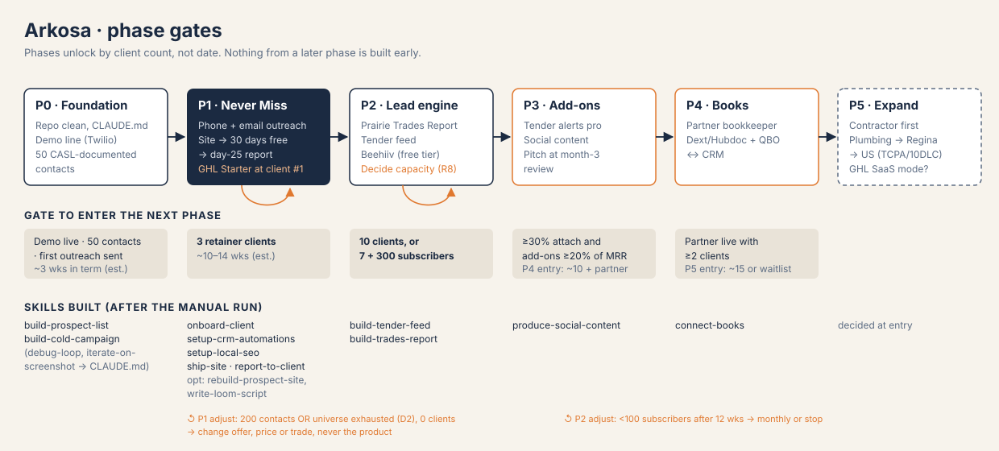
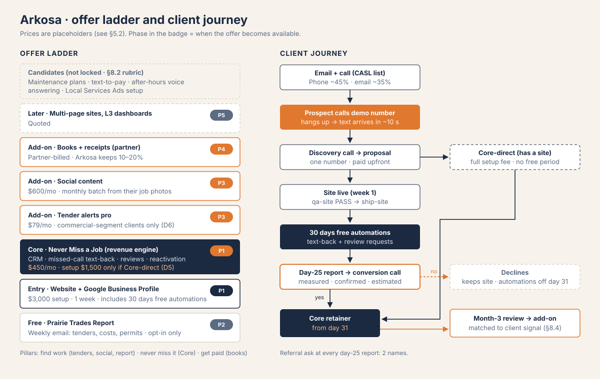

# 0 · Read this first

## 0.1 What this document is

- It is the **operating layer** on top of v2. v2 §1–§8 (naming rules, repo structure, the nine skill specs, the local-model addendum, git setup) stay in force except where §0.4 below changes them.
- v2 had no §9/§10. The phased plan and the offer ladder only existed as locked decisions in the v4 brief. They're written down here for the first time.
- Every price in this document is a **PLACEHOLDER** until the pricing discussion. The placeholders only exist so the margin math can be done.
- Anything marked *(est.)* is an estimate. Anything marked *(verified 24 Sep 2026)* was checked by web search that day. USD→CAD conversions use **1.37** *(est.)*.
- **13 Oct 2026:** §10 adds the competitive position against DIY builders, low-cost edges, call routing, call summaries, the client dashboard, and the AI voice agent. It proposes decisions D7–D10 for sign-off. Nothing in §1–§9 changes until those are accepted (§10.8 lists the knock-on edits).

## 0.2 Inputs from the 24 Sep interview

| Question | Answer | Consequence |
|---|---|---|
| Trade · city | **HVAC · Saskatoon** | `admin/ICP.md`. Furnace season starts now, so missed calls cost the most over the next 6 months. |
| Hours | **~15 h/wk in term, no in-person outreach** | Channel mix is email + phone only. The weekly split needs adjusting (§0.3, decision D1). |
| Tool budget before client #1 | **$100–250/mo** | Stack in §5.1 comes to about $140/mo *(est.)*. |
| Starting prices | **Deferred** | Placeholders are used throughout (§5.2). |

## 0.3 Problems found with locked decisions. Your sign-off is needed

Each item below has a recommended default. **The plan is written as if you accept each default.** If you reject one, the section it points to changes. Nothing else does.

| # | Locked decision | The problem | Recommended default | Affects |
|---|---|---|---|---|
| **D1** | 20 h sales / 14 h build per week | You have ~15 h in term. The split assumes 34 h. | Keep the **ratio**, not the hours. **Term: 9 h sales / 6 h build. Break: 20 / 14.** The rule "if building eats sales hours, building stops" still applies. | §1, §2 |
| **D2** | Phase 1 adjust criterion: "200 contacts produce no client" | Saskatoon has roughly **35–80 HVAC businesses** *(est.; one directory lists 33 verified, another 37)*. There aren't 200 HVAC contacts in one city. Even at 80, a 2% reply rate gives ~1.6 replies, which is statistically meaningless. | The adjust check fires at **whichever comes first**: (a) 200 contacts, or (b) **universe exhausted**, meaning every documented Saskatoon HVAC firm has had 3 emails + 2 call attempts. When (b) fires, the list extends in this order: **Saskatoon plumbing-and-heating firms** (same buyer, same missed-call problem, messaging becomes "heating") → **Regina HVAC** (outreach is remote-only anyway). The first-touch message changes city. The offer doesn't change. | §2.2, §7 |
| **D3** | Demo runs on the GoHighLevel trial | The GHL trial lasts **14 days** *(verified 24 Sep 2026; some affiliate links offer 30)*. A demo number that dies mid-campaign is worse than none. | Build the demo on **Twilio + a small Vercel function** (~$3/mo). GHL is still bought at client #1. Start the GHL trial only when a proposal is out, and use it to rehearse that client's build. | §1, §5 |
| **D4** | GHL "bought when client #1 signs" (tier unspecified) | **Starter ($97 USD) allows 3 sub-accounts and has no API access** *(verified)*. Phase 1 is exactly 3 clients, but site clients in their free 30 days also take a sub-account, and automated reporting needs the API. | Buy **Starter** at client #1. Upgrade to **Unlimited ($297 USD)** when either a 4th sub-account is needed or `report-to-client` needs the API, whichever comes first. Until then, reports are built from CSV exports. | §5, §9 |
| **D5** | Core = setup fee + monthly; site clients get automations free for 30 days | If a site client converts on day 28, charging them the full Core setup fee for automations that are already running is a hard sell. | **Site clients who convert pay no Core setup fee.** The site fee absorbed it. Core-direct clients (no site) pay the full setup. Settle the exact numbers in the pricing talk. | §3, §5 |
| **D6** | Tender alerts pro as a general add-on | Mostly **residential** HVAC firms don't bid public tenders. The add-on only fits the commercial-mechanical segment. | Keep it in Phase 3, but forecast attach from the **commercial-segment count in `ICP.md`**, not from all clients. | §8 |

D7–D10 (response guarantee, dashboard and mobile, AI voice agent, call recording and summaries) are proposed in §10.7.

## 0.4 Changes to v2 carried by this document

1. **v2 §4.0 frontmatter template includes `when_to_use`, which the validator rejects.** Delete that key. Trigger examples go in a `## Triggers` body section. The same fix applies to every v2 generation prompt, which all say "Add when_to_use".
2. **v2 §4.1 `build-site` defaults brochure sites to Astro.** The locked stack is **React/Next.js + Tailwind** on Vercel. Update `references/stack-decision.md` to Next.js-first (static export for brochure sites).
3. **`debug-loop` and `iterate-on-screenshot` stop being skills.** Their rules become two short sections in `CLAUDE.md` (Phase 0, week 1). v2 §4.7–4.8 are archived.
4. **`CLAUDE.md` fixes:** `[NICHE]` → HVAC, `[GEOGRAPHY]` → Saskatoon, SK. `/site-qa-checklist` → `/qa-site`. Map the L1/L2/L3 wording to the offer ladder: L1 = Entry, L2 = Core, L3 = Later.
5. **Repo state, found 24 Sep:**
   - There are placeholder files literally named `*`, `**`, `***` and `****` in `admin/`, `templates/` and every `skills/<dept>/`, plus `skills/delivery/build-site/x`.
   - There's a **nested untracked clone at `Agency/`** inside the repo.
   - **`qa-site` isn't in the repo.**

   All of this is fixed in Phase 0, week 1 (§1).
6. v2 §5 build order is replaced by the per-phase build lists in §6 and §7.

---

# 1 · Phase 0 · Foundation, week by week

**Entry:** now. **Exit check, all three required:** the demo number is live and has passed 3 test calls from 2 carriers · the sending tool (Instantly) holds 50 contacts with the 4 CASL fields filled · the first outreach has been sent (the first email batch has left Instantly *and* the first 10 dials are done).

Planned for **term mode (15 h/wk)**, starting Monday 28 Sep. Expect ~3 weeks. At break-mode hours it would take ~1.5 weeks.

Owner key: **I** = Illia · **CC** = Claude Code (you supervising) · **LM** = local model on the Mac mini (batch work, reviewed by you).

## Week 1 · 28 Sep – 4 Oct · the rails

| Task | h | Owner | Bucket | Done when |
|---|---|---|---|---|
| Repo cleanup: delete the `*`-named and `x` placeholder files (replace with `.gitkeep`), remove the nested `Agency/` clone, commit `qa-site` from wherever it lives, commit the v2 .docx, push | 1.5 | I + CC | build | `git status` clean, `qa-site` visible on GitHub, OneDrive set to "Always keep on this device" |
| `CLAUDE.md`: add the `debug-loop` and `iterate-on-screenshot` rules, apply the §0.4 fixes, add 2 voice samples (real messages you've sent) | 1.5 | I | build | Pricing TODO stays open and is marked "pending pricing talk" |
| Buy the sending domain (e.g. `getarkosa.ca`, not the main domain), set up 2 Workspace inboxes, SPF/DKIM/DMARC, connect Instantly, **start warm-up** | 2 | I | sales | Warm-up running. It needs about 2–3 weeks, which is why it starts in week 1. |
| `admin/ICP.md`: HVAC · Saskatoon; residential vs commercial split; **count the universe** (Google Maps, City of Saskatoon open data, Yably/HomeStars/BBB, Heating Refrigeration and Air Conditioning Institute (HRAI) member directory) | 3 | I | sales | The universe count is recorded. It decides D2. |
| List: first 25 rows with source URL, capture date, no-refusal check and relevance rationale (§2.5) | 5 | I (LM drafts the relevance rationale) | sales | 25 rows pass the §2.5 checklist |
| Register the Twilio number (306 area code) for the demo | 0.5 | I | build | Number provisioned |
| Set up a business line for your own calls (a second Twilio/VoIP number forwarding to your mobile) | 0.5 | I | sales | Outbound caller ID is the business, not your personal mobile |
| **Total** | **14** | | 10.5 sales / 3.5 build | |

## Week 2 · 5 – 11 Oct · the demo

| Task | h | Owner | Bucket | Done when |
|---|---|---|---|---|
| Demo backend: Twilio voice webhook → no answer after N rings → SMS in under 10 s ("Sorry we missed you, this is Northgate Heating. What's going on with your furnace?"), with STOP handling and rate limits (CLAUDE.md: auth + cost caps) | 3 | CC | build | 3 test calls, 2 carriers, text arrives in under 10 s |
| Demo site: fictional "Northgate Heating & Air" via `build-site`, then `qa-site` | 3 | CC | build | `qa-site` has no FAIL. The site says it's a demo in the footer. |
| List: rows 26–50 | 5 | I + LM | sales | 50 rows pass §2.5 |
| Contract pack draft: MSA (with a data-handling schedule, since client customer data goes into GHL), SOW, scope statement. Start from a reputable Canadian template. | 3 | I + CC | sales | Drafts in `templates/contracts/`. A lawyer review is optional *(est. $500–1,500)* and recommended before client #1. |
| **Total** | **14** | | 8 sales / 6 build | |

## Week 3 · 12 – 18 Oct · first touch

| Task | h | Owner | Bucket | Done when |
|---|---|---|---|---|
| Write the 3-email sequence by hand (outline in §2.3), load it into Instantly, send to the first 15 contacts at ≤10/inbox/day | 2 | I | sales | First batch sent. **Phase 0 exit (a).** |
| First 10 dials using the call opener (§2.3) | 1.5 | I | sales | Calls logged in `admin/metrics.md`. **Phase 0 exit (b).** |
| `build-prospect-list` v0, written **after** the 50 manual rows, with v2 §4.4 fixes (4 CASL fields mandatory, no `when_to_use`) | 2 | CC | build | Skill validates. Re-running it on 5 raw rows reproduces your manual output. |
| `build-cold-campaign` v0, written after the manual sequence | 2 | CC | build | Same test |
| CASL wording for text-back, review requests and reactivation (§2.5 part B) in `templates/contracts/casl-wording.md` | 1 | I | build | Wording fixed before any client is live |
| Buffer: rows 51–60, follow-ups, metrics setup | 3 | I | sales | `admin/metrics.md` week 1 row filled |
| **Total** | **11.5** | | 6.5 sales / 5 build (plus 3.5 buffer) | |

**If Phase 0 slips past week 4:** the cause is almost always building. Cut the demo site to a single page. Cut the second skill, since `build-cold-campaign` can wait until Phase 1 week 2. Don't cut list quality.

---

# 2 · Phase 1 · Never Miss a Job

**Entry:** Phase 0 exit. **Target / exit:** 3 retainer clients. **Adjust check:** D2, i.e. 200 contacts **or** universe exhausted with 0 clients (§2.6).

## 2.1 Weekly operating rhythm (term mode, 15 h)

| Block | h/wk | What happens | Output |
|---|---|---|---|
| List building | 2 | 15–20 new rows with CASL fields | New rows in the sending tool, not the repo (CLAUDE.md: personal data stays out of git) |
| Email | 1 | Replies, positive-reply handling, sequence tweaks | Reply log |
| Phone | 3 | ~30 dials in 3 blocks. Best windows are 7:00–8:00 and 16:30–17:30 (owners are in the truck mid-day) *(est.)* | Dial log |
| Discovery / demo calls | 2 | 1–2 per week (20 min each, plus prep) | Call notes → `clients/<prospect>/` only after they sign |
| Metrics + review | 1 | Friday: update `admin/metrics.md`, run the funnel check (§4) | Weekly row |
| Build / delivery | 6 | **Before client #1:** tighten the demo, finish the contract pack, rehearse the build on the GHL trial *only when a proposal is out*. **After client #1:** delivery first, then write the skill that delivery just exercised. | — |

**Break mode (34 h):** the same blocks scaled to 20 / 14. Extra sales hours go to phone calls first, because phone converts better than email in a market this small.

## 2.2 Activity targets and the arithmetic behind them

| Per week (term) | Target | Assumption *(all est.; revise after 4 weeks of data)* |
|---|---|---|
| New documented contacts | 15–20 | You have ~2 h and one contact takes 6–8 min with CASL checks |
| Emails sent | 45–60 | 3-step sequence × new contacts |
| Dials | 30 | 3 × 1 h blocks at 10 dials/h |
| Owner conversations | 6–9 | 20–30% connect rate to a decision-maker on trades lines |
| Demo-number calls by prospects | 2–3 | About a third of conversations agree to "call it now" |
| Discovery calls booked | 1–2 | |
| Proposals | ~0.5–1 | 50% of discovery calls |
| Closes | ~1 per 3–4 weeks | 30% of proposals |

**What this means for timing:**
- At 15–20 contacts a week, the Saskatoon HVAC universe (35–80) runs out around **week 4–6 of Phase 1**.
- 200 contacts, if the D2 list extension is used, arrives around **week 10–13**. That puts the Phase 1 go/no-go read at **mid-December to mid-January**.
- Three closes at ~1 per 3–4 weeks is about **10–14 weeks**, so Phase 1 exit lands around late January *(est.)*.
- Remember phases unlock by client count, not date. These dates are forecasts, not deadlines.

## 2.3 Outreach outlines

Voice rules come from `CLAUDE.md`: plain, specific, name the number, no hype, no "AI-powered".

### First-touch email (under 90 words)

- **Subject:** `missed calls at {Company}` (lowercase, no punctuation tricks)
- **Line 1:** one verifiable fact about *them*, e.g. "Your Google profile says 24/7 emergency service, and the listed number goes to voicemail after 5 pm."
- **Line 2:** the cost, e.g. "In January, a furnace call that hits voicemail usually calls the next company on the list."
- **Line 3:** the proof they can try right now: "Call (306) XXX-XXXX and hang up. You'll get a text back in about 10 seconds. That's what your customers would get."
- **Ask:** "Worth 10 minutes this week?"
- **Footer:** name, Arkosa, postal address, one-line unsubscribe. *(You need a mailing address. A home address works; a mailbox service is ~$20–30/mo (est.).)*
- **Email 2 (day 4):** one number, e.g. their review count vs the top competitor. **Email 3 (day 9):** the ask steps down: "Want me to send a 60-second video instead?"

### Call opener (30 seconds)

1. "Hi, it's Illia from Arkosa here in Saskatoon. This is a cold call. Can I have 30 seconds, and then you can hang up on me?"
2. "When your guys are on a job and the phone rings, who picks it up?"
3. Let them answer. Most owners say "me", "my wife" or "voicemail".
4. "That's the only thing I fix. Missed calls get a text back in seconds, so the customer waits for you instead of calling the next company."
5. Go to the demo pitch.

### Demo-number pitch

- "Don't take my word for it. Call this number right now, let it ring, and hang up." Stay on the line (or call back) while they do it.
- When the text arrives: "That goes out from *your* number, with *your* name, 24/7. Plus a review request after every job, and a winter tune-up text to everyone you've served in the last two years."
- Close for the next step, not the sale: "Can I get 20 minutes Thursday to show you what it'd look like with your numbers?" **Never quote a price before that call** (CLAUDE.md).

## 2.4 Channel mix

| Channel | Share of sales hours (term) | Role |
|---|---|---|
| Phone | ~45% | Primary. Small market, owner-operators, and it's where the demo number lands best. |
| Email | ~35% (list + replies) | Warms the phone call ("I sent you a note Tuesday") and reaches owners who never answer. |
| In-person | 0% | Excluded (your choice). Revisit in Phase 5 or if D2 fires with 0 clients. Supply-house counter days are the cheapest in-person test. |
| Referrals | as they come | After client #1: ask every client for 2 names at the day-25 report |

## 2.5 CASL checklist

This isn't legal advice. Get your contract/CASL wording reviewed once before client #1.

**A. Cold email to prospects (your list).** Every row needs all four fields or it doesn't get sent:

- [ ] **Source URL** where the email address is conspicuously published (the firm's website, GBP, a directory)
- [ ] **Capture date**
- [ ] **No-refusal check:** no statement near the address like "no solicitations". Record where you looked.
- [ ] **Relevance rationale:** why the message relates to their role (e.g. "owner of HVAC firm; message about their inbound call handling")
- [ ] Every message identifies you, gives a mailing address plus email/phone/web contact, and has an unsubscribe that works for 60 days after sending and is honoured within 10 business days
- [ ] Suppression list checked before every send, and never deleted
- [ ] **No cold SMS. Ever.** No texts to prospects, including "just following up".
- [ ] Cold **phone calls** fall under the CRTC Unsolicited Telecommunications Rules, not CASL. B2B calls are generally exempt from the National DNCL but still need an **internal do-not-call list** and identification. Calling-hour limits apply. *(Verify the current rules before your first dial.)*
- [ ] Conspicuous publication only covers a *business* message. Never add these prospects to the Prairie Trades Report newsletter. That needs express opt-in.

**B. Client-side messages (sent on the client's behalf). The wording must be fixed before client #1.**

| Message | Consent basis *(verified: CRTC implied-consent guidance)* | Rule to build into the workflow |
|---|---|---|
| Missed-call text-back | Implied, from an **inquiry**: valid for **6 months** from the call | Sends only in reply to an inbound call. Identifies the business. Includes "Reply STOP to opt out". |
| Review request | Implied, from a **purchase**: valid for **2 years** from the transaction | Triggered by job completion. One request plus at most one reminder. STOP honoured. |
| Database reactivation | Implied from a **purchase within the last 2 years only** | **Hard gate:** the import script drops any contact with no last-job date or a last job older than 2 years. Everyone else needs express consent. |
| Quote follow-up | Implied from the **inquiry** (6 months). Messages that only deliver a requested quote may have narrower rules *(verify)*. | Sequence stops at the first reply or STOP |

## 2.6 Adjust decision tree (fires on the D2 trigger)

| Symptom at the check | Diagnosis | Change (offer, price or trade, never the product) |
|---|---|---|
| Reply rate under 2% | The message or the list is wrong | Build the optional `rebuild-prospect-site` + `write-loom-script` (locked), rewrite line 1 of the email, extend the list per D2 |
| Replies fine, few demo calls | The ask is too big | Lead with the demo number only. Drop the meeting ask from email 1. |
| Demos fine, few closes | Offer or price | Lower the setup fee. Stronger risk reversal: automations first, site optional. Price test after 3 no's for the same reason. |
| Closes fine, but day-25 conversion under 50% | The report or the offer | Rework the day-25 report (§3.4). Check the missed-call counts were real. |
| Nothing works after the list extension | Trade | Switch the messaging trade to plumbing (the second choice from the interview) |

---

# 3 · Sales-to-retainer flow

## 3.1 Stages

| Day | Stage | Gate to move on | Artifact |
|---|---|---|---|
| −7 to 0 | Discovery call (20 min): their call volume, who answers, average job value, their field-service software (Jobber/Housecall Pro/ServiceTitan/paper) | Average job value and monthly inbound call count are **stated by the client** and written down. The 5× case depends on them. | Call notes |
| 0 | Proposal: one page, **one number** (CLAUDE.md), value before price. Entry offer shown with the 30-day automation trial built in. | Client says yes to the number | `templates/proposals/` (after proposal #2; freehand before that) |
| 0 | Contract pack: MSA + SOW + scope statement, signed electronically | Signed, and **payment received upfront** (CLAUDE.md) | Signed PDFs |
| 1 | Onboarding: long-lead items start the same day (GBP access, DNS, SMS number port or new number). Manual for client #1, `onboard-client` from client #2 onward. | Access checklist complete | `clients/<name>/context.md` |
| 1–7 | Site build → `qa-site` → `ship-site`. Text-back + review requests go live **the day the number is live**, even if the site isn't. | `qa-site` has no FAIL | Live site |
| 1–30 | **Free automation period.** Monitor weekly: missed calls, texts, replies, reviews. | — | Running log |
| 25 | **Day-25 report** (§3.4) sent 48 h before the call | Numbers are labelled *measured*, *client-confirmed* or *estimated* | Report |
| 26–28 | **Conversion call** (§3.5) | Yes → retainer auto-charges from day 31. No → automations off on day 31, they keep the site. | Signed retainer SOW, or an off-boarding note |
| 31+ | Retainer: bi-weekly check-in for the first 2 months, then monthly report | Churn watch (§4) | Monthly report |

**Core-direct clients** (they already have a decent site): discovery → proposal → contract → full Core setup fee → go-live. No free period. Day-25 report as a first check-in.

## 3.2 Proposal skeleton

1. What we heard: their numbers, in their words
2. What it costs them now: missed calls × close rate × average job value, stated as a monthly figure
3. What we'll do: 3 bullets
4. What they get in 30 days, and how we'll prove it (the day-25 report)
5. One number, what's included, payment terms
6. Risk reversal: "If the report doesn't show it's working, you keep the site and we switch the rest off. No retainer."

## 3.3 Contract pack contents

- **MSA:** parties, IP (the client owns their site and content; Arkosa keeps its templates and skills), liability cap, data handling (client customer data in GHL, PIPEDA-aligned, deleted or exported on exit), CASL responsibilities (the client confirms its customer list meets the 2-year rule).
- **SOW (Entry):** fixed scope, one page, one week, 2 revision rounds, change-order rate. The free automation period and its end are stated explicitly.
- **SOW (Core retainer):** what runs, the monthly report, response times, **month-to-month with 30 days' notice after the first 3 months** *(proposed, settle in the pricing talk)*, number porting on exit.
- **Scope statement:** included, not included, how changes are handled.

## 3.4 Day-25 report (one page)

| Line | Source | Label |
|---|---|---|
| Inbound calls / missed calls | Call log (GHL or Twilio) | measured |
| Missed calls that got a text / replied / booked | Workflow stats + client confirmation | measured / client-confirmed |
| Jobs booked from recovered calls × average job value | Client-stated job value | estimated |
| Review requests sent / reviews received / rating before → after | GBP | measured |
| What happens on day 31 if they continue / if they don't | — | — |

Rule: **never claim a number that wasn't measured** (v2 `write-loom-script` rule, now applied to reporting). If recovered revenue is under the retainer price, say so and propose the fix. That's what "relationship accountability" means.

## 3.5 Conversion call and objection handling

Open with the report, not the price. Ask "What surprised you?" Then: "Keep it running?"

| Objection | Response |
|---|---|
| "We use Jobber / Housecall Pro, it already texts." | "Keep it. It's where your jobs live. This covers the calls that never become a job in Jobber, because nobody answered them. Your report shows {N} of those." |
| "Too expensive." | Point to the recovered-revenue line. If that line is under the price, don't argue: offer a shorter commitment, or let it switch off. |
| "I'll just call people back myself." | "You did, for {N} of the {M} missed calls. The report shows the gap." |
| "Texting customers feels spammy." | It only replies to people who called them or bought from them, within the legal windows, with STOP on every message. |
| "My nephew does my website." | "Keep him on the site. I'm not replacing it; this runs underneath your phone number." |
| "We're slammed, no time." | "That's when missed calls are highest. Setup takes you 30 minutes." |
| "Let me think about it." | "Sure. The automations switch off on day 31 unless you say go. Want me to hold them until Friday?" |
| "What if you disappear?" | Number porting and data export on exit are in the contract. You're local and the reports are monthly. |

---

# 4 · KPI dashboard

## 4.1 What gets measured, per phase

| KPI | Definition | P0 | P1 | P2 | P3 | P4 | P5 |
|---|---|---|---|---|---|---|---|
| Contacts (cumulative) | Unique documented firms that got a first touch | 50 | 200 or universe | — | — | — | — |
| New contacts / wk | | 15–25 | 15–20 | 10 | 10 | 10 | per-trade |
| Reply rate | Replies ÷ emails delivered | — | ≥2% | ≥2% | — | — | — |
| Dials / conversations | | 10 / — | 30 / 6–9 wk | 20 / wk | | | |
| Demos (demo number called + discovery) | | — | 1–2 / wk | | | | |
| Closes | Signed + paid | — | 3 retainers | 10 total | | | |
| Retainer conversion | Retainers ÷ free periods ended | — | ≥50% | ≥60% | ≥60% | | |
| Churn (monthly) | Retainers lost ÷ retainers at start of month | — | 0 | ≤3% | ≤3% | ≤3% | ≤3% |
| MRR | Core + add-ons | 0 | ~$1.35k* | ~$4.5k* | ~$5.9k* | ~$7.3k* | ~$9k+* |
| Add-on attach | Clients with ≥1 add-on ÷ clients | — | — | — | ≥30% | | |
| Add-on share of MRR | | — | — | — | ≥20% | | |
| Subscribers (Trades Report) | | — | — | 300 (or 100 by week 12) | | | |
| Delivery h / client / month | | — | ≤5 | ≤3 | ≤3 | ≤3 | ≤2 |
| Sales-hours ratio | Sales h ÷ total h | ≥55% | ≥55% | ≥50% | | | |

\*MRR from placeholder pricing (§5).

## 4.2 `admin/metrics.md` template

The same template is written to `admin/metrics.md` in the repo. Aggregates only, no personal data.

```markdown
# Arkosa metrics
Phase: 0 · Mode: term (15 h) · Universe (Saskatoon HVAC): __ · Updated: YYYY-MM-DD

## Weekly
| Week of | Sales h | Build h | New contacts | Cum. contacts | Emails sent | Replies | Positive | Dials | Convos | Demo-number calls | Discovery | Proposals | Closes |
|---|---|---|---|---|---|---|---|---|---|---|---|---|---|
| 2026-09-28 | | | | | | | | | | | | | |

## Clients
| Client (trading name) | Offer | Signed | Free period ends | Day-25 result | Retainer? | MRR | Add-ons | Delivery h/mo |
|---|---|---|---|---|---|---|---|---|

## Monthly
| Month | Clients | MRR | Add-on MRR | Setup revenue | Tool cost | Churned | Retainer conv. | Margin on MRR |
|---|---|---|---|---|---|---|---|---|

## Gate check (update monthly)
- Current phase exit: __ / __
- Adjust trigger status: __
- Sales-hours ratio last 4 wks: __ %  (under 55% → building stops)
```


---

# 5 · Unit economics per phase

## 5.1 Tool stack and costs (CAD per month, estimates at 1.37 USD→CAD)

| Tool | Tier | List price | CAD/mo *(est.)* | From | Notes |
|---|---|---|---|---|---|
| Instantly | Growth, monthly billing | $47 USD *(verified)* | 64 | P0 | Unlimited inboxes and warm-up are included. Switch to annual ($37.60 USD) once Phase 1 proves out. |
| Google Workspace | 3 seats (main + 2 sending) | ~$14 CAD/seat *(est.)* | 42 | P0 | |
| Domains | main `.ca` + 1 sending domain | ~$20/yr each *(est.)* | 4 | P0 | |
| Twilio (demo line) | 1 local number + SMS | $1.15 USD/number + $0.0083 USD/SMS *(verified)* | 3 | P0 | Resolves D3 |
| Vercel | Pro, 1 seat | $20 USD *(verified)* | 27 | P0 | **Hobby doesn't allow commercial use.** The demo is commercial. One seat covers every client site. |
| GoHighLevel | Starter | $97 USD *(verified)* | 133 | Client #1 | 3 sub-accounts, no API (D4) |
| GoHighLevel | Unlimited | $297 USD *(verified)* | 407 | 4th sub-account or API need | |
| GoHighLevel | SaaS Pro | $497 USD *(verified)* | 681 | P5, optional | Only if rebilling usage is worth it |
| LC Phone (per client) | number + ~300 SMS segments | $1.15 USD + ~$0.0075 USD/segment + carrier fees *(verified)* | ~7 | Client #1 | Rebilled inside the retainer, not itemised (CLAUDE.md: one number) |
| Beehiiv | Launch (free) | $0 up to 2,500 subscribers *(verified)* | 0 | P2 | Scale is $43 USD/mo if you ever need it |
| Local models (Mac mini) | — | $0 marginal | 0 | P2+ | Captions, drafts, classification, transcription |
| Claude subscription | — | existing | — | — | Excluded; already paid |

**Fixed cost before client #1: ~$140/mo**, inside the $100–250 budget. One-time: optional contract review *(est. $500–1,500)*.

## 5.2 Placeholder prices (to be replaced after the pricing talk)

| Offer | Placeholder | Locked range |
|---|---|---|
| Entry: site + GBP | $3,000 setup | $2,000–4,000 |
| Core setup (Core-direct only, per D5) | $1,500 | $1,000–2,000 |
| Core retainer | $450/mo | $300–600 |
| Tender alerts pro | $79/mo | $49–99 |
| Social content | $600/mo | $400–800 |
| Books + receipts | partner bills ~$450/mo; Arkosa keeps 15% ≈ $68 | $300–600; 10–20% |

## 5.3 Per-phase model (at each phase's exit state)

| | P0 | P1 exit | P2 exit | P3 exit | P4 exit | P5 entry |
|---|---|---|---|---|---|---|
| Clients | 0 | 3 | 10 | 10 | 12 | 15 |
| Setup revenue (cumulative, one-time) | 0 | ~$9k | ~$30k | ~$30k | ~$36k | ~$45k |
| Core MRR | 0 | 1,350 | 4,500 | 4,500 | 5,400 | 6,750 |
| Add-on MRR | 0 | 0 | 0 | 1,358 (2 social, 2 tender) | 1,758 | 2,200 |
| Books share | 0 | 0 | 0 | 0 | 204 (3 clients) | 340 |
| **Total MRR** | **0** | **1,350** | **4,500** | **5,858** | **7,362** | **9,290** |
| Tool cost / mo | 140 | 294 (Starter) · 568 if Unlimited is forced | 617 | 640 | 655 | 926 (SaaS Pro) + contractor |
| Margin on MRR after tools | — | 78% (58%) | 86% | 89% | 91% | 90% before contractor |
| Delivery h/client/mo (target) | — | ≤5 | ≤3 | ≤3 (+4 per social client) | ≤3 | ≤2 |
| Delivery h/mo | 0 | 15 | 30 | 39 | 52 | 45–50 |
| **Target margin** | — | **≥60%** | **≥80%** | **≥80%** | **≥80%** | **≥70% after contractor** |

**Two things this table shows:**

1. **Capacity ceiling at term hours.** 15 h/wk is ~65 h/month. Keeping ≥50% of hours on sales leaves ~32 h for delivery, which is **about 10 clients at 3 h each**. Phase 3 and later **don't fit in term mode.** Before Phase 3 you need one of three things: more hours, delivery at ≤2 h/client, or the Phase 5 contractor brought forward. That's a decision to make at the Phase 2 exit. It's on the risk register (R8).
2. **GST.** Cumulative setup revenue passes **$30k around the Phase 2 exit**, which is the small-supplier threshold measured over four consecutive quarters. Register before you cross it. Confirm the Saskatchewan PST treatment of web and software services with an accountant before the first invoice.

---

# 6 · Phase 1 skills (v0 outlines)

**Rules for all five:**
- Each skill is **written after the first manual run**: v0 after client #1, rewritten after client #3.
- No `when_to_use` frontmatter; triggers go in the body.
- `SKILL.md` stays under ~200 lines, with reference material in `references/` and anything scriptable in `scripts/`.
- Names checked against bundled commands: none of these collide.

## 6.1 `onboard-client` (operations)

v2 §4.9 remains the spec. v4 changes only these:

- **Purpose.** A signed and paid client → everything in the first 24 h.
- **Triggers.** "we closed {client}", "onboard {client}", "signed, what now".
- **Inputs.** Signed SOW, proof of payment, discovery notes, offer type (Entry or Core-direct).
- **Gates.** Refuses to start without payment received (CLAUDE.md). Refuses to mark complete while GBP access, DNS access or the SMS number is outstanding. **New:** refuses to import any customer list without a last-job date column (CASL 2-year rule, §2.5 B).
- **Outputs.** `clients/<name>/context.md` + `spec.md`, long-lead checklist with owners, kickoff email, bi-weekly call series for the free period, **day-25 report date on the calendar**.
- **Open questions.** Where the free-period end date lives (GHL custom field vs calendar). Whether number porting belongs here or in `setup-crm-automations`.
- **Build after:** client #1's manual onboarding.

## 6.2 `setup-crm-automations` (delivery)

- **Purpose.** Stand up a client's GHL sub-account with the Core automations: missed-call text-back, review request, database reactivation, quote follow-up (GHL estimates, since quoting SaaS is deferred).
- **Triggers.** "set up the CRM for {client}", "turn on text-back", "build their automations".
- **Inputs.** `clients/<name>/context.md`, business hours, the owner's mobile number, GBP review link, customer list with last-job dates, CASL wording from `templates/contracts/casl-wording.md`.
- **Gates.**
  - The CASL wording is used verbatim.
  - The reactivation import script drops rows older than 2 years or with no date.
  - STOP handling is verified by test.
  - 3 test calls from 2 carriers.
  - Every workflow is logged in a `workflows.md` with its trigger and consent basis.
  - **Refuses to go live without all of the above.**
- **Outputs.** A live sub-account, `workflows.md`, a test log, and the free-period start date.
- **Open questions.** Whether to build a GHL **snapshot**. Per "templates come from real builds", that happens after client #2 at the earliest. How to connect Jobber or Housecall Pro job-completion events to the review trigger (Zapier or native).
- **Build after:** client #1's manual setup.

## 6.3 `setup-local-seo` (delivery)

- **Purpose.** Get the client's Google Business Profile and local citations right, so the site and the reviews count toward local ranking.
- **Triggers.** "do their local SEO", "fix their GBP", "set up citations for {client}".
- **Inputs.** GBP manager access (**the client owns it; Arkosa is a manager**), canonical NAP, service area, categories, photos with written permission.
- **Gates.**
  - NAP is identical across the site, GBP and every citation.
  - Refuses to create a duplicate GBP.
  - A baseline is captured before any change: rating, review count, and map-pack position for 3 queries, with a screenshot.
- **Outputs.** Baseline file, change log, citation list (Canadian directories: Yelp.ca, Canada411/YellowPages, HomeStars, BBB, 411.ca *(verify the current set)*), LocalBusiness schema handed to `build-site`.
- **Open questions.** How to measure rank without a paid tool. Whether citations are worth the hours in a 35–80 firm market.
- **Build after:** client #1.

## 6.4 `ship-site` (delivery)

- **Purpose.** Take a site that passed `qa-site` to production on the client's domain, then hand over.
- **Triggers.** "ship it", "go live for {client}", "deploy to production".
- **Inputs.** Repo, `qa-site` report, domain/DNS access, env var names.
- **Gates.**
  - **Refuses to deploy unless the latest `qa-site` report has zero FAIL.**
  - Final payment is confirmed.
  - The client has signed off in writing.
  - Env vars come from Vercel settings, never from the repo.
  - A post-deploy `qa-site` run on the production URL passes.
- **Outputs.** Production URL, DNS record log, handover doc (logins through the password manager, how to request changes), analytics and call tracking confirmed firing.
- **Open questions.** Client-owned vs Arkosa-owned Vercel project (affects exit and porting). Domain registrar standard.
- **Build after:** client #1's launch.

## 6.5 `report-to-client` (operations)

- **Purpose.** Produce the day-25 conversion report and the monthly retainer report (§3.4) from GHL data.
- **Triggers.** "day-25 report for {client}", "monthly report", "how's {client} doing".
- **Inputs.** GHL export (CSV while on Starter; API after the Unlimited upgrade, per D4), GBP stats, the client-stated average job value.
- **Gates.**
  - Every number is labelled *measured*, *client-confirmed* or *estimated*.
  - Refuses to state recovered revenue without a client-stated job value.
  - If value delivered is less than the price, the report says so and proposes a fix.
- **Outputs.** One-page report (PDF + email body), a row appended to `admin/metrics.md` (aggregates only), 3 talking points for the call.
- **Open questions.** How to attribute "booked" jobs (a GHL pipeline stage vs the client's word). Whether a local model can draft the narrative from the numbers reliably enough (a good fit for supervised batch work).
- **Build after:** client #1's first day-25 report, done by hand.

## 6.6 Optional (only if D2 fires with reply rate under 2%)

`rebuild-prospect-site` and `write-loom-script`, built from the v2 §4.3 and §4.6 specs with the §0.4 fixes. Not built otherwise.


---

# 7 · Phases 2–5 (one page each, no build detail)



## 7.1 Phase 2 · Lead engine

- **Entry trigger.** 3 retainer clients.
- **Scope.** The **Prairie Trades Report**: a free weekly email (Beehiiv Launch) covering public tenders, material-cost trends, local building permits, and fuel and wage trends. It's the "find work" pillar and a consented audience you can market to. Plus the tender feed that powers it.
- **Build list.** `build-tender-feed`, `build-trades-report`. Nothing else.
- **Time budget.** Build: ~4–6 weeks of the 6 h/wk build block. Steady state: **≤1.5 h/wk** to produce the report (a local model drafts, you edit). Sales hours don't drop.
- **Sources to check first.** Official feeds first: SaskTenders, CanadaBuys open data, City of Saskatoon permits and open data, Statistics Canada price indexes, public fuel-price data. Check each portal's terms before automating it.
- **Risks.**
  - CASL: express opt-in only; prospects are never bulk-added.
  - Trades owners may not read newsletters.
  - A data source's terms may forbid redistribution.
- **Adjust criterion (locked).** Under 100 subscribers after 12 weeks → cut to monthly or stop, and give the hours back to outreach.
- **Exit.** 10 clients, **or** 7 clients + 300 subscribers.
- **Decision due at exit.** How you'll resolve the capacity ceiling (R8) before Phase 3.

## 7.2 Phase 3 · Add-ons

- **Entry trigger.** 8–10 clients.
- **Scope.** Launch **Tender alerts pro** (commercial-segment clients, D6) and **Social content** (§8). Pitch add-ons at each client's month-3 review, using their own data.
- **Build list.** `produce-social-content`, written after 2 manual monthly batches. Tender alerts reuse `build-tender-feed`, so there's no new skill.
- **Time budget.** Social: ≤4 h/client/month (local models: Whisper for captions, Kokoro for voice-over, Flux schnell only for graphics, **never fake job photos**). Tender alerts: ≤0.5 h/client/month.
- **Risks.**
  - Social is the most hours-hungry add-on, and cutting it as a standalone offer was deliberate. Keep it add-on only.
  - Local-model output reaching clients unreviewed.
- **Adjust criterion.** Attach under 15% after 3 months in phase → reprice or drop the weaker add-on.
- **Exit.** ≥30% of clients on an add-on, **and** add-on revenue ≥20% of MRR.

## 7.3 Phase 4 · Books

- **Entry trigger.** About 10 clients **and** a partner bookkeeper signed.
- **Scope.** **Books + receipts**: Dext or Hubdoc + QuickBooks Online connected to the CRM (invoice and payment sync). The bookkeeping itself is done and billed by the partner. Arkosa keeps a 10–20% share or a resale margin.
- **Partner criteria.** QBO ProAdvisor, Saskatchewan-based, already serves trades, has capacity for 5+ clients, will sign a referral agreement with **disclosed** referral fees.
- **Build list.** `connect-books`.
- **Time budget.** Setup 3–4 h/client, ongoing ≤0.5 h/client/month. Partner recruitment ~6–8 h, which can start in Phase 3 as a *sales* activity (it's not building).
- **Risks.**
  - The partner's service quality reflects on Arkosa.
  - Accounting-data access and liability.
  - Referral-fee disclosure.
- **Adjust criterion.** No partner signed within 8 weeks of the Phase 4 trigger → stay in Phase 3 and keep recruiting.
- **Exit.** Partner live with ≥2 Arkosa clients.

## 7.4 Phase 5 · Expand

- **Entry trigger.** About 15 clients, or a waitlist.
- **Scope.** Second trade (plumbing is next per the interview) → second prairie city (Regina) → US.
- **Revisit.** Deferred items: quoting SaaS **only** if 10 or more clients ask for the same missing feature. GHL SaaS mode. A delivery contractor.
- **Build list.** Decided at phase entry. Nothing is pre-committed.
- **Time budget.** Contractor at ~20 h/month *(est. $35–50/h)* before any new trade. The capacity ceiling makes this the first move.
- **Risks.**
  - US compliance is a different regime: CAN-SPAM for email, **TCPA and A2P 10DLC for SMS** (stricter, and expensive to get wrong).
  - Currency.
  - Contractor quality.
  - Second-city messaging drift.
- **Adjust criterion.** A second trade's first 100 contacts produce no client → go back to the first trade and expand the city instead.

---

# 8 · Add-on roadmap



## 8.1 Locked add-ons

| Add-on | Pillar | Who it's for | Phase | Price (placeholder) | Delivery | h/client/mo | Margin *(est.)* | Launch gate | Kill criterion |
|---|---|---|---|---|---|---|---|---|---|
| **Tender alerts pro**: daily matched tenders pushed into the client's CRM as opportunities | Find work | Commercial and mixed HVAC firms (the `ICP.md` commercial count) | 3 | $79/mo | `build-tender-feed` (P2) + a matching rule per client | ≤0.5 | ~95% | Feed has run ≥8 weeks for the Trades Report with <10% false matches | <2 subscribers after 3 months in Phase 3 |
| **Social content**: a monthly batch of 8–12 posts + 2–4 reels from the client's own job photos and clips | Find work | Firms with photos to share and a thin GBP/social presence | 3 | $600/mo | `produce-social-content`, local models, GHL Social Planner | ≤4 | ~85% | 2 manual batches delivered before the skill is written | >5 h/client/mo after 3 months, or it drives churn |
| **Books + receipts**: Dext/Hubdoc + QBO connected to the CRM; bookkeeping by the partner | Get paid | Firms with receipt chaos and slow invoicing | 4 | Partner-billed ~$450; Arkosa 15% ≈ $68 | `connect-books` + partner | ≤0.5 | ~95% of Arkosa's share | Partner signed; referral terms disclosed | Partner quality complaints |
| **Multi-page sites, L3 dashboards** | — | Growing firms | 5 | Quoted | `build-site` extended; shadcn/ui | Project | — | 15 clients | — |

## 8.2 Candidate add-ons (not locked; enter only through the §8.3 rubric, no earlier than Phase 3)

These are proposals for your review, not new commitments. Nothing here gets built before its phase (locked rule).

| Candidate | Pillar | Why it fits HVAC | Main risk |
|---|---|---|---|
| **Maintenance-plan program**: recurring furnace/AC tune-up memberships, billed through GHL payments, with seasonal reminder texts | Get paid + never miss it | Recurring revenue for the client. Tune-up reminders are a natural extension of reactivation. | The client must run the plan operationally |
| **Text-to-pay + invoice reminders** (GHL invoices) | Get paid | Faster cash for owners who invoice from the truck. A bridge to Books. | Overlaps with Jobber/Housecall Pro payments |
| **After-hours voice answering**: a voice agent picks up missed calls and captures the job details, extending text-back (spec in §10.6) | Never miss it | Winter emergency calls at 2 am | Call quality, per-minute cost, liability for a mishandled emergency |
| **Local Services Ads setup + monthly review** | Find work | Google-screened ads sit above the map pack for HVAC searches *(check Canadian availability for Saskatoon HVAC)* | Ad management is hours-heavy. Keep it to setup + monthly review. |

Already ruled out, not re-proposed: fractional finance dashboards, standalone quoting SaaS, standalone receipt app, in-house bookkeeping, standalone social clients, on-prem AI boxes, French localization.

## 8.3 Add-on admission rubric (all six required)

1. **Demand:** ≥3 clients asked unprompted (quoting SaaS keeps its locked bar of 10).
2. **Hours:** ≤2 h/client/month after month 2 (social is the exception at ≤4).
3. **Margin:** ≥70% after tools.
4. **Stack:** runs on GHL, Vercel, a partner, or the Mac mini. No new platform dependency.
5. **Positioning:** clearly serves one of *find work*, *never miss it* or *get paid*.
6. **Compliance:** the consent basis for any message is documented before launch.

## 8.4 When to pitch which add-on

| Client signal (from the monthly report or intake) | Pitch |
|---|---|
| Does commercial work, or has mentioned bids | Tender alerts pro |
| Sends job photos, fewer than 2 GBP posts a month | Social content |
| Mentions receipts, slow invoicing, year-end panic | Books + receipts (P4) |
| Asks about membership plans or tune-up reminders | Maintenance-plan program (candidate) |

Pitch at the **month-3 review**, never during the free period. The free period sells Core only.

---

# 9 · Risk register

| # | Risk | Likelihood | Impact | Mitigation | Trigger to act |
|---|---|---|---|---|---|
| R1 | **GHL dependency** (price changes, policy, outage, the Starter limits in D4) | Med | High | `workflows.md` per client so every workflow can be rebuilt elsewhere; client data export in the MSA; demo on Twilio (D3) | GHL price +20%, or a 2nd multi-hour outage in a quarter |
| R2 | **CASL** (penalties up to $10M per violation for businesses *(verify)*) | Low with process | Very high | §2.5 checklist, 4-field rows, suppression list, wording review, no cold SMS | Any complaint → pause sends and audit |
| R3 | **Small market**: 35–80 firms; a bad campaign burns the city | High | High | Low volume, personal first lines, D2 list extension, referrals | Unsubscribe or complaint rate >1% |
| R4 | **Single trade + seasonality**: owners unreachable in cold snaps | High | Med | Sell hardest Oct–Nov and in shoulder seasons; plumbing is the next trade | Contact rate drops >40% for 2 weeks |
| R5 | **Incumbent software** (Jobber, Housecall Pro, ServiceTitan bundle texting and reviews) | High | Med | Position as the layer for calls that never became jobs; ask about their software on discovery | 3 losses citing existing software |
| R6 | **OneDrive/git setup**: nested clone, placeholder files, sync conflicts, and the repo sits in a **university** OneDrive that may lose access when your USask status changes | High | Med | Phase 0 week 1 cleanup. **Recommend moving the repo out of the university OneDrive** to a local folder with GitHub as the source of truth. | Now |
| R7 | **Arcosa SEO clash** (same pronunciation, publicly traded) | Med | Low–Med | Brand for "Arkosa Saskatoon" plus GBP; don't compete on the bare word; CIPO trademark search before brand spend | Before buying the main domain or any brand assets |
| R8 | **Capacity at term hours**: ceiling ~10 clients (§5.3) | High from P2 | High | Delivery ≤3 h/client, skills cut hours, contractor brought forward | Decide at Phase 2 exit |
| R9 | **Key person / exam weeks** | Med | High | Skills as runbooks, monitoring alerts, **no launches in exam weeks**, retainer SOW response times that cover exams | Term calendar |
| R10 | **SMS filtering by Canadian carriers** | Med | High | Test on 2 carriers, no URL shorteners, business name in every text | Delivery rate <95% |
| R11 | **Local-model output reaching clients unchecked** | Med | Med | Supervised batch only (locked); human review gate in every skill that uses one | Any client-facing error |
| R12 | **Liability for a failed automation** (missed text on an emergency call) | Low | Med | MSA liability cap, monitoring, E&O insurance quote *(est.)* | Before client #1 |

R13–R15 are proposed in §10.8.

---

# 10 · Competitive position and client-facing extensions (intake, 11–13 Oct 2026)

## 10.0 Status

- This section records the 11–13 Oct discussion. **Nothing in it is locked.** Proposed defaults follow the §0.3 convention: the plan assumes the default unless you reject it (decisions D7–D10, §10.7).
- Vendor prices are USD as published, *(verified 11 Oct 2026)* unless marked *(est.)*. CAD at 1.37 *(est.)*.
- Phases still unlock by client count. Nothing here is built before its phase.

## 10.1 Position against DIY builders (Wix, Squarespace)

**Finding.** On the website alone Arkosa loses: Squarespace starts at $19/mo after a 14-day trial; Wix Light is $17/mo; both have AI site generators. Squarespace now also sells Scheduling, Invoicing, Email and SMS Campaigns, SEO/"AI Visibility" tools and a Home Services vertical. Wix has offered phone-assistant apps through its App Market. Assume feature parity on text-back eventually.

**The edge is the work they leave to the owner:**

| Aspect | Wix / Squarespace | Arkosa |
|---|---|---|
| Who does the work | Owner (or a freelancer via "Hire an Expert") | Done for them; ~30 min of owner time at setup |
| What's bought | A tool | An outcome: missed calls → booked jobs |
| Up-front cost | ~$17–19/mo | Setup + retainer (placeholders §5.2). **Never compete on this line.** |
| Missed calls | Not core; bolt-on apps owner configures | Core: text-back from their number in ~10 s, tested on 2 carriers |
| Follow-up / reviews | Broadcast campaigns the owner writes | Triggered workflows (review request, quote follow-up, 2-yr reactivation) |
| Local ranking | Site SEO settings only | `setup-local-seo`: GBP, citations, NAP, baseline |
| Quality gate | None | `qa-site` blocks launch on any FAIL |
| CASL on client messages | Owner's responsibility | Consent windows built into workflows |
| Proof | Traffic analytics | Day-25 report in dollars, every number labelled |
| Accountability | Global ticket support | Local operator; free 30-day automation period |
| They win on | Price, speed (minutes), self-editing, 24/7 platform reliability | — |

**Positioning rules (proposed):**
1. Don't sell against them; sell on top of them: "Keep your Wix site. This runs under your phone number." A builder customer is a Core-direct prospect, not a lost sale.
2. Lead with the phone (demo number), never the website.
3. Price against the cost of missed jobs (client-stated numbers, §3.2 line 2), never against a subscription.
4. Make hidden work visible in the proposal: one line each for CASL gating, `qa-site`, GBP, 2-carrier testing.
5. The moat is the day-25 report plus local accountability, not features.

## 10.2 Low-cost edges

| Edge | Type | Setup cost *(est.)* | When |
|---|---|---|---|
| **Response guarantee**: every missed call texted within 60 s, 24/7, or that month is free (D7) | Promise | 0 | Phase 1, first proposal |
| **Live in 48 h**: text-back before the site | Promise | 0 | Phase 1 |
| **Easy-exit contract** (already §3.3) said out loud in the pitch | Promise | 0 | Phase 1 |
| **Weekly owner digest**: Monday SMS with missed / texted / replied / booked | Core | ~20 min once | Client #1 |
| **Emergency escalation**: reply keywords (no heat, furnace, gas, CO, emergency) page the owner; gas/CO auto-reply with the safety line ("leave the house, call 911 / gas utility emergency line") | Core | ~1 h + reviewed wording | Client #1 |
| **Review reply drafts**: local model drafts, owner approves | Core | minutes/month | Client #1 |
| **Competitor review line** in monthly report | Core | minutes/month | Client #1 |
| **Weather-triggered tune-up texts**: Environment Canada cold-snap forecast → past customers ≤2 yrs (CASL purchase rule) | Core | ~4–6 h once, reused for all clients | Clients 2–3, before peak winter |
| **Reply classification** (job type, urgency) in reports | Core | ~2–3 h, local model batch | With `report-to-client` |
| **Rebate-ready quoting** (heat pumps / high-efficiency) | Add-on candidate | depends | Phase 3, **only if programs are live — verify first** |
| **Anonymized peer benchmark** (aggregates only, disclosed in MSA) | Core | low | 5+ clients |
| **Trades referral network** (opt-in, non-competing trades) | Add-on / retention | low | Phase 5 |

Skipped: call recording by default (see §10.4), AI voice in Phase 1, anything on the §8.2 ruled-out list.

## 10.3 Call routing, tracking and answering

**Arkosa never answers or listens to client calls.** Owner and staff answer as today; the system acts only when nobody picks up. Your access to recordings, if any exist, is limited to debugging.

**Tracking options:**

| Option | How | Pros | Cons |
|---|---|---|---|
| **Conditional forwarding** (default for client #1) | Carrier forwards no-answer/busy calls to a GHL number | No change for the owner; fast; reversible | Sees missed calls only; forwarding setup differs by carrier (SaskTel, Bell, Rogers, Telus) — test per client |
| Port number into GHL | Number moves to GHL, rings owner's phones | Full call log; enables recording | Days–weeks to port; owner nervous; exit clause must port it back |
| New tracking number | GHL number on site/GBP | Source attribution | Two numbers in circulation; NAP consistency risk |

**Live answering options, cheapest first:** (1) ring several phones at once (owner, office, dispatcher); (2) after-hours routing to the on-call tech; (3) text-back (current Core); (4) human answering service for overflow/after hours (client contracts directly; get quotes); (5) AI voice agent (§10.6, Phase 3). **Phase 1 default: 1 + 2 + 3.**

## 10.4 Call summaries and suggested actions

| | Missed calls | Answered calls |
|---|---|---|
| Source | Voicemail + text-back thread | Recording (opt-in) |
| Consent | None beyond existing text-back basis | Disclosure at call start; PIPEDA notice and purpose; wording reviewed with the contract pack *(not legal advice)* |
| Coverage | All forwarded misses | Only calls routed through the GHL number |
| Processing | GHL built-in if adequate *(check)*, else Mac mini overnight batch; urgent ones still use the instant keyword alert | Prefer GHL's own transcription; if the Mac mini is used, audio leaves GHL → MSA data schedule + delete audio after transcription |
| When | Client #1 | Opt-in pilot with one client after clients 2–3 (D10) |

**Rule:** suggested actions are drafts. The owner approves with one tap; nothing goes to a customer automatically. Answered-call summaries are an upgrade, not free Core.

## 10.5 Client dashboard and mobile

**Texts push, dashboards pull. Use both:** the Monday digest carries 1–2 headline numbers and links to the dashboard, which holds the detail. The dashboard's main screen is a **call feed: who called, what they wanted, what to do next** — that's the version owners will open.

| | A. GHL native | B. GHL white-label | C. Arkosa app (multi-tenant) |
|---|---|---|---|
| Client sees | GHL sub-account + standard mobile app | Same, Arkosa-branded | Call feed, summaries, next actions, reports |
| Monthly cost | $0 on Starter | Unlimited $297 (branded desktop + domain); **white-label mobile app +$497/mo** | Needs Unlimited for API (+$200/mo vs Starter); existing Vercel Pro; DB/email free tiers *(est.)*; AI summaries cents/call *(est.)* |
| One-time | ~2 h | ~3–5 h *(est.)* | ~30–50 h v1 with Claude Code *(est.)* → 5–8 weeks at 6 build h/wk |
| Ongoing | ~0 | ~0 | ~1–3 h/month *(est.)* |

**Mobile:** GHL standard app $0 (Phase 1) · white-label app $497/mo (skip until well past 15 clients) · **installable web app (PWA) from option C, push notifications on iOS, ~$0 extra (default)** · native iOS app: Apple developer $99/yr + est. 60–100+ h + App Store reviews (skip).

Build C once, multi-tenant: Next.js on Vercel, magic-link login restricted to the client's email domain, strict per-client data separation. Never per-client dashboards (breaks the ≤3 h/client target).

## 10.6 AI voice agent (Phase 3 add-on candidate)

**Costs:**

| Option | Cost |
|---|---|
| GHL Voice AI, pay-per-use | ~$0.06/min engine + TTS base, plus LLM tokens and telephony; ~$0.16/min typical all-in |
| GHL AI Employee Growth | $50/mo per sub-account, 100 Voice AI min included |
| GHL AI Employee Unlimited | $97/mo per sub-account, unlimited Voice AI (telephony still metered); wins above ~500 min/mo |
| Retell | $0.07–0.31/min; ~$0.11–0.15/min realistic |
| Vapi | $0.05/min hosting only; $0.12–0.40/min all-in |
| Bland | ~$0.11–0.14/min bundled |

GHL Voice AI can run on an existing number (since Apr 2026). **Per-client example:** 40 calls × 2 min = 80 min × ~$0.16 ≈ $13 USD/mo, or Growth plan. Real cost is your time: ~4–6 h setup, ~1 h/month transcript review *(est.)*. Market resale is $1–3/min; Arkosa would sell a flat after-hours add-on, placeholder $100–200/mo.

**Settings sheet** (per client, in `clients/<name>/workflows.md`, with a test-call set re-run after every change):

1. **When** — after N rings / after hours / busy; hours and holidays; existing customers (CRM allowlist) skip the agent
2. **Introduction** — business name, discloses it's automated, recording notice if on, calm voice
3. **Collects** — name, callback number, address/area, problem, urgency, new vs existing; stops once collected
4. **May say** — hours, service area, callback promise. **Never** prices, diagnoses, warranty promises; booking only with a connected, accurate calendar
5. **Emergency rules (fixed, not adjustable)** — gas/CO/smoke → leave the house + 911 + gas utility line, page owner; no heat in winter → transfer to on-call, else page
6. **Handoff** — live transfer on request or urgency
7. **After call** — summary + suggested action to owner, confirmation text to caller, CRM contact + tags
8. **Cost caps** — max call length (e.g. 4 min), monthly minute cap (CLAUDE.md: hard cost caps)

Owner can change only toggles (on/off, hours, on-call number, callback promise). Script changes go through Arkosa and the test set. Check which settings GHL exposes natively vs via prompt/workflow before building.

**Spam filtering, layered:** (1) carrier caller-ID verification / spam labels (STIR/SHAKEN) where passed through; (2) blocklist + existing-customer allowlist; (3) agent screening question, polite exit for sales calls, silent/recorded calls end in seconds; (4) no text-back to spam; (5) spam counted separately so day-25 numbers aren't inflated. **Default to letting calls through:** tag suspected spam, never block silently; review tags weekly for the first month; blocklist only confirmed numbers.

## 10.7 Proposed decisions — sign-off needed

| # | Decision | Recommended default | Affects |
|---|---|---|---|
| **D7** | Response guarantee | 60-second text-back guarantee in the Core SOW: a system miss makes that month free | §3.3, §3.5 |
| **D8** | Dashboard and mobile | Phase 1: GHL native + standard app + text digest. When D4 forces Unlimited: build option C as a PWA. No white-label mobile app, no native iOS app. | §5, §6.5 |
| **D9** | AI voice agent | Phase 3 add-on via GHL AI Employee Growth per client; flat price (placeholder $100–200/mo); emergency rules fixed; passes the §8.3 rubric first | §8.2 |
| **D10** | Call recording and summaries | Missed-call summaries in Core from client #1. Recording off by default; opt-in pilot after clients 2–3 with disclosure; summaries are draft actions only | §3.3, §6.2 |

## 10.8 Knock-on changes elsewhere (apply on sign-off)

- **§3.3 contract pack:** D7 guarantee; recording disclosure and consent; audio deletion window in the MSA data schedule; disclosure of anonymized benchmarks.
- **§3.4 / §6.5 `report-to-client`:** spam excluded from missed-call counts; reply classification; competitor review line.
- **§6.2 `setup-crm-automations`:** add emergency keyword escalation, weekly owner digest, spam tagging, phone-routing setup (ring group, after-hours routing, conditional forwarding test per carrier).
- **§8.2 candidates:** add rebate-ready quoting, recorded-call summaries, trades referral network. After-hours voice answering now has the spec in §10.6.
- **§9 risks (proposed):** **R13** voice agent mishandles an emergency (fixed rules, transfer, liability cap, E&O); **R14** builders reach feature parity on text-back (moat = accountability and report, §10.1); **R15** custom dashboard maintenance load (single multi-tenant build, PWA only).


---

# Appendix A · Why (short)

- **D1, ratio over hours:** the 20/14 rule protects a ratio (sales ≥ ~55%), not a number. Keeping the ratio at 15 h keeps the protection.
- **D2, universe-exhausted trigger:** with n ≈ 60 and p ≈ 2%, a "no client after N contacts" test has too little power to tell a bad offer from bad luck. Touch depth (3 emails + 2 calls) is the controllable variable.
- **D3, Twilio demo:** the demo is the single most important sales asset in Phase 1. It can't have a 14-day expiry.
- **Phone first:** in a 35–80 firm market, each firm is worth more than a cold email's attention. A call with a live demo is the highest-signal touch you can afford at 9 h/wk.
- **Placeholder prices:** they keep the margin math honest without pre-deciding the pricing talk.
- **D8, texts plus dashboard:** trades owners don't log in to read charts; a pushed number keeps retention, and a call feed with next actions is the only dashboard screen they'll open.
- **D9/D10, voice and recording later:** usage is cheap; the real costs are emergency liability, consent and your time.

# Appendix B · Sources (checked 24 Sep 2026)

- GoHighLevel plans and 14-day trial: [thesmartfunnel.com](https://thesmartfunnel.com/2026/07/29/gohighlevel-pricing/), [ghldesk.com](https://ghldesk.com/gohighlevel-free-trial/)
- LC Phone Canada pricing: [HighLevel support](https://help.gohighlevel.com/support/solutions/articles/48001223556-lc-phone-pricing-billing-guide)
- Instantly plans: [cleanlist.ai](https://www.cleanlist.ai/blog/2026-09-01-instantly-pricing-guide)
- Twilio Canada SMS and number pricing: [twilio.com](https://www.twilio.com/en-us/sms/pricing/ca)
- Beehiiv plans: [beehiiv.com/pricing](https://www.beehiiv.com/pricing)
- Vercel Hobby commercial restriction, Pro seat price: [schematichq.com](https://schematichq.com/blog/vercel-pricing)
- CASL implied consent periods and conspicuous publication: [CRTC guidance](https://crtc.gc.ca/eng/com500/guide.htm)
- Saskatoon HVAC universe *(estimate)*: [PublicLeads](https://www.publicleads.com/hvac-contractors/canada/saskatchewan/saskatoon), [Yably](https://yably.ca/hvac-contractors/saskatoon)

**Added for §10 (checked 11 Oct 2026):**

- Squarespace product range and $19/mo starting price: [squarespace.com](https://www.squarespace.com/)
- Squarespace Aug 2026 price change: [costbench.com](https://costbench.com/changelog/squarespace-price-decrease-2026-08/)
- Wix plans: [stylefactoryproductions.com](https://www.stylefactoryproductions.com/blog/wix-pricing)
- Wix phone assistant (Goodcall, older article): [techradar.com](https://www.techradar.com/news/wix-turns-to-ai-to-help-users-deliver-247-customer-support)
- GHL Voice AI and AI Employee pricing: [botpenguin.com](https://botpenguin.com/blogs/gohighlevel-ai-pricing), [netpartners.marketing](https://netpartners.marketing/gohighlevel-voice-ai/), [thestackinsiders.com](https://www.thestackinsiders.com/blog/gohighlevel-voice-ai-cost)
- Retell pricing: [krispcall.com](https://krispcall.com/general/retell-ai-pricing/), [11x.ai](https://www.11x.ai/guides/retell-ai-pricing)
- Vapi pricing: [dailyaifixs.com](https://dailyaifixs.com/blog/vapi-pricing-2026-0-05-min-is-only-hosting)
- GHL white-label and mobile app add-on: [setsmart.io](https://setsmart.io/blog/gohighlevel-white-label)

---

> **Mirror note:** there's no `agency-plan-v4.docx` yet. Create it from this file (`pandoc agency-plan-v4.md -o agency-plan-v4.docx` works, and the SVGs embed). From now on, mirror every change to this file into that .docx. `agency-plan-v2.docx` is superseded except for v2 §1–§8, which this document references. **13 Oct: mirror §10, the §0.1/§0.3 notes, the §8.2 voice-answering pointer and the Appendix A/B additions.**
